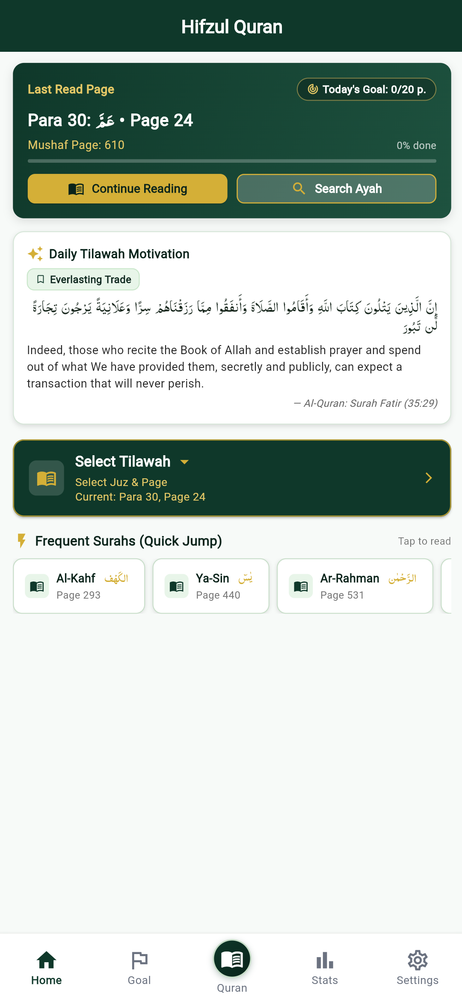
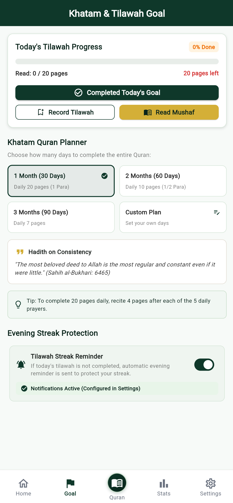
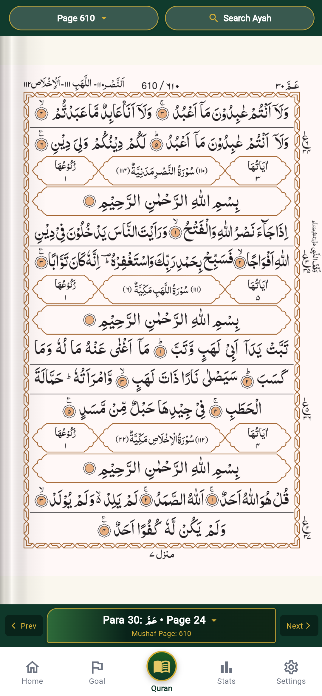
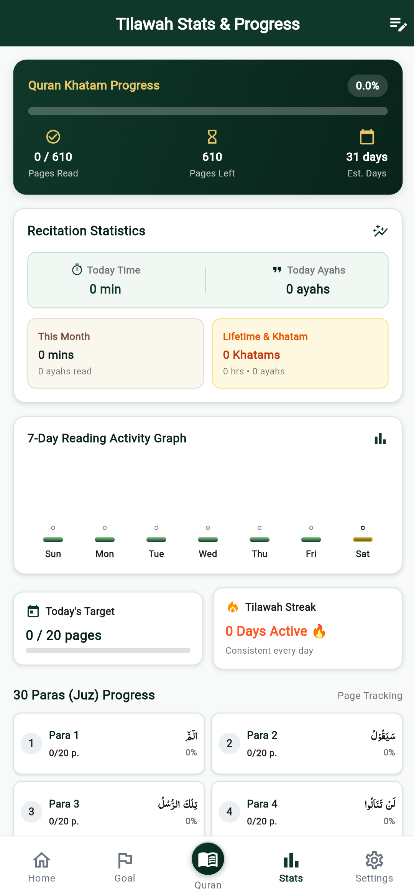
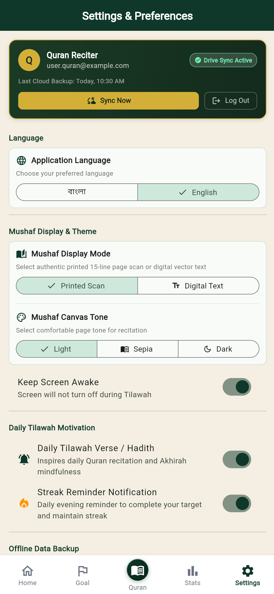
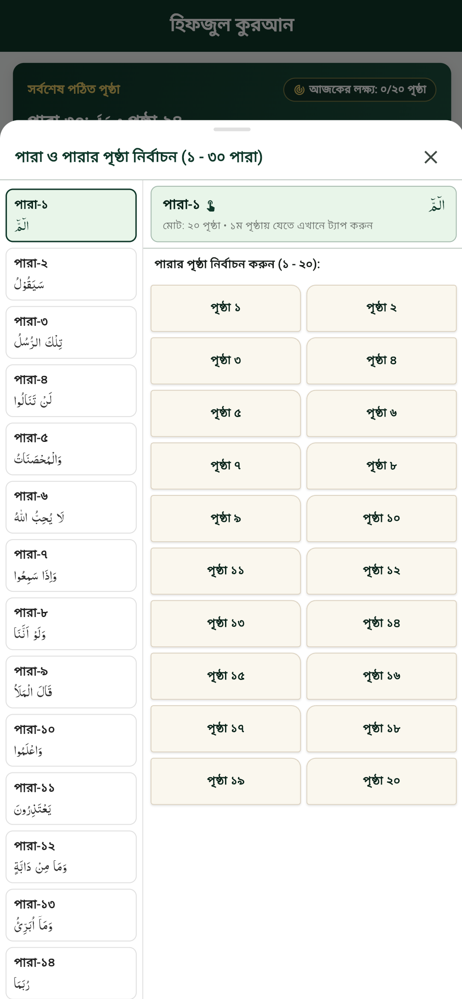

# হিফজুল কুরআন • Hifzul Quran 📖✨

হাফেজ ও তিলাওয়াতকারীদের জন্য সম্পূর্ণ অফলাইন, বিজ্ঞাপনমুক্ত ঐতিহ্যবাহী **১৫ লাইনের নূরানী মুসহাফ**, স্বয়ংক্রিয় খতম প্ল্যানার, দৈনিক স্ট্রিক সুরক্ষা এবং **গুগল ড্রাইভ ক্লাউড ব্যাকআপ** সুবিধাযুক্ত একটি আধুনিক ইসলামিক অ্যাপ্লিকেশন।

> 🌐 **লাইভ ওয়েবসাইট:** [https://direct2amin.github.io/hifzulquran/](https://direct2amin.github.io/hifzulquran/)  
> 🔒 **প্রাইভেসি পলিসি (Privacy Policy):** [https://direct2amin.github.io/hifzulquran/privacy-policy.html](https://direct2amin.github.io/hifzulquran/privacy-policy.html)  

---

## 🌟 মূল বৈশিষ্ট্যসমূহ (Key Features)

1. **📖 ১৫ লাইনের আসল নূরানী মুসহাফ ও ৩ডি শেডিং (Authentic 15-Line Mushaf & 3D Spine Shade):**
   - উপমহাদেশের ঐতিহ্যবাহী নূরানী ছাপার পৃষ্ঠা যাতে পৃষ্ঠা ও লাইনের অবস্থান অপরিবর্তিত থাকে।
   - **আসল বইয়ের মতো গ্রেডিয়েন্ট শেড:** পাতার ভাঁজে বাস্তবসম্মত ৩ডি শেডিং দেখে এক পলকেই বোঝা যায় পৃষ্ঠাটি ডান পাশের নাকি বাম পাশের—ঠিক যেমন আসল কাগজের মুসহাফের ক্ষেত্রে বোঝা যায়।
   - চোখে আরামদায়ক ৩টি মোড: ডে মোড (Light), সেপিয়া (Sepia), এবং নাইট মোড (Dark)।

2. **🎯 কুরআন খতম ও তিলাওয়াত লক্ষ্য (Khatam & Recitation Planner):**
   - ১ মাস (৩০ দিন), ২ মাস (৬০ দিন), ৩ মাস (৯০ দিন) বা কাস্টম মেয়াদে খতম প্ল্যানিং।
   - স্বয়ংক্রিয় দৈনিক পৃষ্ঠা গণনা ও অগ্রগতি ট্র্যাকিং।
   - মাগরিবের পর সন্ধ্যার স্ট্রিক সুরক্ষা রিমাইন্ডার যাতে আমল কখনো বন্ধ না হয়।

3. **☁️ গুগল ড্রাইভ ক্লাউড ব্যাকআপ (Google Drive Sync):**
   - কোনো বাহ্যিক সার্ভার নেই—আপনার তিলাওয়াত ডেটা সম্পূর্ণ নিরাপদে সরাসরি আপনার ব্যক্তিগত গুগল ড্রাইভে ব্যাকআপ থাকবে।
   - নতুন ফোনে স্যুইচ করলে এক ক্লিকেই পূর্বের অগ্রগতি পুনরুদ্ধার।

4. **🚫 ১০০% বিজ্ঞাপনমুক্ত ও সম্পূর্ণ অফলাইন:**
   - কোনো ব্যানার, পপ-আপ বা ইন্টারনেটের প্রয়োজন নেই। সম্পূর্ণ মনোযোগ সহকারে একাগ্রতার সাথে তিলাওয়াত।

5. **🔍 শক্তিশালী সার্চ ও জাম্প নেভিগেশন:**
   - সূরা, পারা বা পৃষ্ঠা নম্বরে সরাসরি জাম্প।
   - ভয়েস সার্চ ও টেক্সট সার্চের মাধ্যমে দ্রুত আয়াহ ও সূরা অনুসন্ধান।

6. **🌐 দ্বিভাষিক সাপোর্ট (Bengali & English):**
   - সেটিংস থেকে এক ট্যাপেই সম্পূর্ণ অ্যাপ বাংলা অথবা ইংরেজিতে পরিবর্তনের সুবিধা।

---

## 📱 স্ক্রিনশটসমূহ (Screenshots)

  <table>
    <tr>
      <td align="center"><strong>১. হোম স্ক্রিন</strong></td>
      <td align="center"><strong>২. খতম লক্ষ্য</strong></td>
      <td align="center"><strong>৩. নূরানী মুসহাফ</strong></td>
    </tr>
    <tr>
      <td></td>
      <td></td>
      <td></td>
    </tr>
    <tr>
      <td align="center"><strong>৪. তিলাওয়াত স্ট্যাট</strong></td>
      <td align="center"><strong>৫. সেটিংস ও ক্লাউড সিঙ্ক</strong></td>
      <td align="center"><strong>৬. পারা সিলেক্টর</strong></td>
    </tr>
    <tr>
      <td></td>
      <td></td>
      <td></td>
    </tr>
  </table>

## 📄 লাইসেন্স (License)

এই প্রজেক্টটি [MIT License](LICENSE)-এর অধীনে উন্মুক্ত।

## 👤 ডেভেলপার (Developer)

- **ডেভেলপার:** Amin
- **যোগাযোগ:** [direct2amin@gmail.com](mailto:direct2amin@gmail.com)
